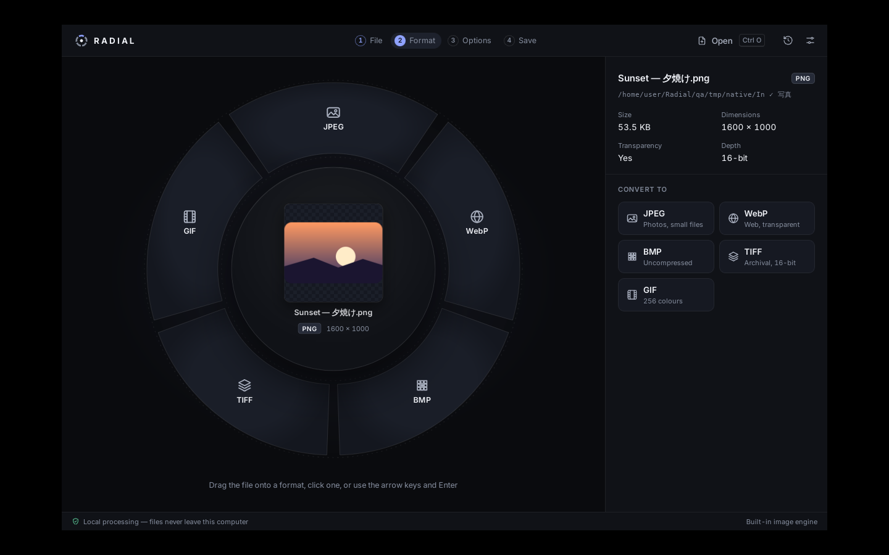

# RADIAL

**Local-first file conversion with a radial format selector.**

RADIAL is a desktop app for Windows 10/11 (macOS-ready architecture). Drop an image, drag it onto a
format in the ring around it, adjust only the options that matter, and save. Every conversion runs
on your computer — no uploads, accounts or telemetry.



## What it does today (v0.1)

| | |
| --- | --- |
| **Formats** | PNG, JPEG, WebP, BMP, TIFF and GIF — any of them to any other (30 conversions). See [docs/SUPPORTED_FORMATS.md](docs/SUPPORTED_FORMATS.md). |
| **Choose a format three ways** | drag the file onto a segment · click a segment · keyboard (arrows, `Enter`, `1`–`9`). A conventional list in the side panel offers the same choices. |
| **Options** | JPEG/WebP quality, lossless WebP, background colour for transparency, resize with aspect lock, rotate, crop, brightness, contrast. Only options the target supports are shown. |
| **Preview** | Before/after comparison, fit, zoom, 100 % view. Edits preview through the same pipeline used for export. |
| **Safety** | Content-based type detection, never overwrites (originals or existing files), atomic writes with verification, cancellation that never leaves partial files. |
| **History** | Recent conversions with open / show in folder / retry. Metadata only, stored locally; can be turned off. |

Document (LibreOffice) and audio/video (FFmpeg) conversion are planned — see [ROADMAP.md](ROADMAP.md).
RADIAL never lists a conversion it cannot perform.

## Install

Windows installers (`.msi` and NSIS `.exe`) are produced by the
[Windows build workflow](.github/workflows/ci.yml) as build artifacts. They are **not code-signed
yet**, so Windows SmartScreen will warn on first run — see [docs/PACKAGING.md](docs/PACKAGING.md).

System requirements: Windows 10 (1803+) or 11, x64, with Microsoft Edge WebView2 (preinstalled on
Windows 11; the installer downloads it on Windows 10 if missing). No other runtime dependencies.

## Develop

Prerequisites: Node.js 22+, Rust 1.88+ (stable), and the
[Tauri 2 prerequisites](https://v2.tauri.app/start/prerequisites/) for your OS
(WebView2 + MSVC Build Tools on Windows; `webkit2gtk-4.1` etc. on Linux).

```sh
npm install
npm run tauri dev          # run the desktop app with hot reload
npm run tauri build        # release build + Windows installers (on Windows)
```

Quality checks:

```sh
npm run typecheck          # strict TypeScript
npm run lint               # ESLint
npm test                   # frontend unit/component tests (Vitest)
npm run test:rust          # Rust unit + integration tests (real files, real encoders)
npm run test:ui            # Playwright UI tests against the mock backend
npm run check              # typecheck + lint + both unit suites
```

`npm run dev:mock` runs the interface in a normal browser against an in-memory mock backend. It is
for UI work and UI tests only — the mock performs no conversions.

## Project layout

```
crates/radial-core/   Conversion core (Rust): detection, capability registry, engine, naming, history
src-tauri/            Desktop shell (Tauri 2): window, IPC commands, path allowlist, dialogs
src/                  Interface (React + TypeScript)
  radial/             The radial menu and its geometry
  components/         Panels, preview, dialogs
  state/              Workflow reducer and hooks
  lib/                Backend boundary, shared types, display helpers
  styles/             Design tokens and component styles
e2e/                  Playwright UI tests
qa/screenshots/       Visual QA captures (native app and UI tests)
docs/                 Architecture, formats, security, packaging, QA report
```

## Documentation

- [Architecture](docs/ARCHITECTURE.md) — the capability registry, conversion pipeline and native integration
- [Supported formats](docs/SUPPORTED_FORMATS.md) — exactly what converts, and the known limitations
- [Security & privacy](docs/SECURITY.md)
- [Windows packaging](docs/PACKAGING.md)
- [Design system](docs/DESIGN.md)
- [QA report](docs/QA.md) — what was verified, how, and what remains unverified
- [Contributing](CONTRIBUTING.md) · [Changelog](CHANGELOG.md) · [Roadmap](ROADMAP.md)

## Licence

No licence has been chosen yet; until one is added, all rights are reserved by the owner.
Third-party components keep their own licences (see [docs/SECURITY.md](docs/SECURITY.md#dependencies)).
